# SDN.sozial (LMG) — Leistungsmanagement Grundsicherung
### Enterprise-Transaktionssteuerung & CICS-Ablösung auf Oracle 19c / 23ai

<p align="center">
  
  
  
  
  
  
</p>

<p align="center">
  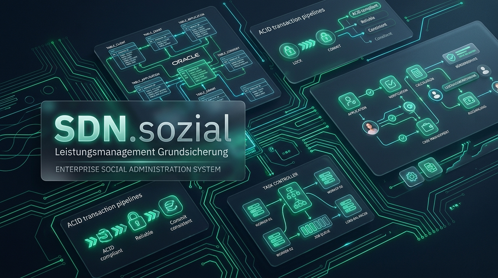
</p>

---

## 📌 Management Summary

**SDN.sozial (LMG)** ist ein hochperformantes, lizenzfreies Referenzsystem für die kommunale Sozialverwaltung (SGB XII Grundsicherung im Alter und bei Erwerbsminderung). Es demonstriert, wie teure, proprietäre Großrechner-Transaktionsmonitore (**IBM CICS Transaction Server**) durch eine schlanke **Eigenentwicklung in modernem Java 21 auf Oracle Database 19c Enterprise Edition / 23ai Free** vollständig abgelöst werden können.

### Das architektonische Leitprinzip

> 💡 **„Der schwere Teil ist die Datenbank – die Steuerung programmieren wir selbst.“**
> 
> ACID-Garantien, zeilenbasierte Sperrverwaltung (*Row-Level Locks*), Redo-Logging und Crash-Recovery beherrscht die relationale Oracle-Datenbank bereits exzellent. Was SDN.sozial liefert, ist die hochverfügbare Steuerung darüber: atomare Transaktionsklammern, automatischer Deadlock-Retry (`ORA-00060`, `ORA-00054`), Parallelitätsbegrenzung mit Watchdog-Timeouts und absturzsichere **Saga-Geschäftsvorgänge** mit automatischem Rollback und Kompensation.

---

> [!NOTE]
> ### 🛡️ Transparenter Showcase-Hinweis & Unabhängigkeitserklärung
> Dieses Projekt ist ein reines **Technologie- und KI-Showcase (Proof of Concept)** zur Demonstration moderner Softwarearchitektur. Die fachlichen Gesetzesgrundlagen (SGB XII Regelbedarfsstufen 2026, Mehrbedarfe, Freibeträge) und relationalen Datenstrukturen wurden autonom im Rahmen von **KI-Deep-Research** ohne menschliche Fachspezifikation ermittelt.
> 
> Es besteht **ausdrücklich keinerlei Bezug zu real existierenden Unternehmen, behördlichen IT-Dienstleistern oder konkreten Softwareanbietern** (die Bezeichnung *„SDN“* ist frei erfunden). Die Anwendung ist vollständig implementiert und lauffähig, befindet sich jedoch in keinem behördlichen Produktiveinsatz.

---

## 🏛️ Gegenüberstellung: IBM CICS vs. SDN.sozial TxManager

| CICS Transaction Server (Mainframe) | SDN.sozial TxManager (Java 21 + Oracle) | Implementierung |
|:---|:---|:---|
| **Atomarität (`EXEC CICS SYNCPOINT`)** | Autonome Commit/Rollback-Klammern über JDBC-Transaktionen | `TxManager.execute(TxOptions, ...)` |
| **Sperren-Konflikte & Deadlocks** | Automatischer Retry mit exponentiellem Backoff & Jitter bei `ORA-00054`, `ORA-00060`, `ORA-08177` | `de.allgemein.tx.RetryPolicy` |
| **Task Control & Concurrency** | Begrenzter Worker-Thread-Pool mit Request-Warteschlange & Überlastschutz | `de.allgemein.tx.TaskController` |
| **Timeouts & Task-Abbruch** | Watchdog-Timer: Unterbricht den Task-Thread, Oracle führt Rollback aus | `TxOptions.timeout(Duration)` |
| **Journalling & Long-Running Sagas** | Persistentes Datenbankjournal mit Vorwärts-/Rückwärts-Kompensation | `de.allgemein.tx.saga.SagaEngine` |
| **Emergency Restart / Crash Recovery** | Automatisches Kompensieren offener Geschäftsvorgänge beim Serverstart (alle registrierten Saga-Typen) | `SagaEngine.recover(...)` |
| **CICS Monitoring & Statistics** | Echtzeit-Telemetrie via JMX MBeans und strukturiertem Audit-Log | `TxMonitoring`, `TxAuditLog` |

---

## 🏗️ Architektur & Kernkomponenten

Das Gesamtsystem basiert auf einem konsequenten **Zero-Framework-Ansatz** (kein Spring, kein Jakarta EE, kein Hibernate). Jede Komponente ist unabhängig testbar, extrem ressourcenschonend und startet in unter **2 Sekunden**.

```
LeistungsmanagementGrundsicherung/
├── ddl/
│   ├── oracle_schema.sql        # Basistabellen: TX_SAGA, TX_SAGA_STEP, TX_DEMO_ANTRAG, TX_DEMO_ZAHLUNG
│   ├── lmg_schema.sql           # Fachschema: BEDARFSGEMEINSCHAFT, SOZIAL_FALL, ZAHLUNG, BESCHEID, JOURNAL
│   └── lmg_seed.sql             # Realitätsnaher Demo-Bestand (SGB XII Leistungsfälle 2026)
├── doc/
│   ├── architektur.md           # Detaillierte technische Architekturspezifikation
│   ├── leistungsmanagement.md   # Fachmodell, Berechnungsformeln und REST-API
│   ├── manual-bilder/           # Hochauflösende Screenshots & Architekturdiagramme
│   └── SDN-sozial-LMG-Benutzerhandbuch.pdf # 42-seitiges Schulungs- & Praxishandbuch
└── src/
    ├── main/java/de/allgemein/tx/   # Kern: Transaktionsmanager, Saga-Engine, Connection Pools
    ├── main/java/de/allgemein/lmg/  # Fachschicht: SGB XII Rechner, DAOs, Services, Webserver
    └── main/resources/webapp/       # Single-Page-App: Widget-Dashboard, Fallbearbeitung, Journal
```

<p align="center">
  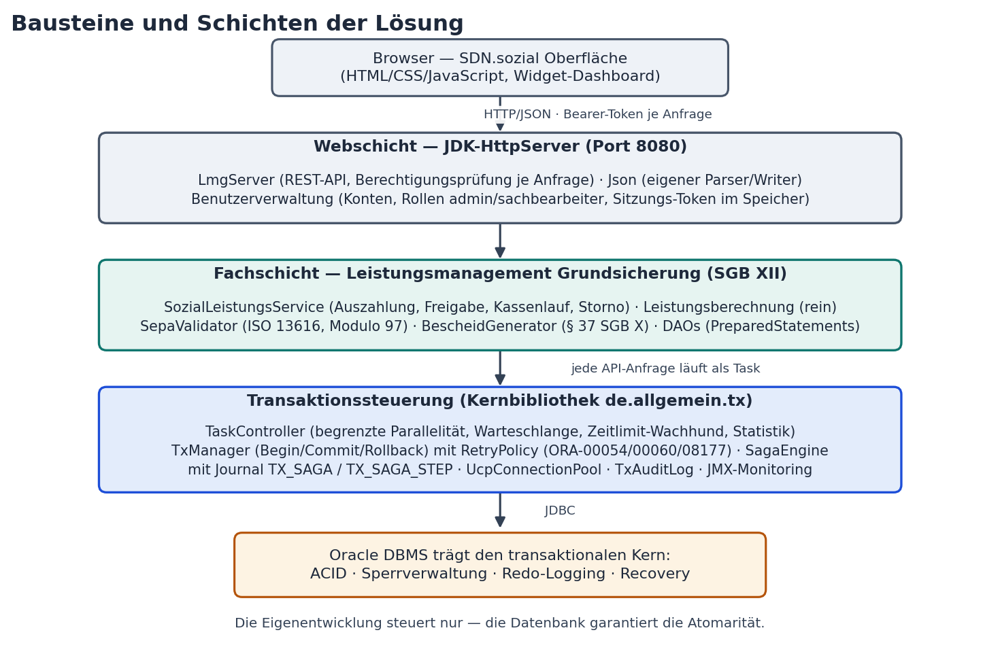
</p>

### 1. Transaktionsmanager (`TxManager`)
Kurze, hochfrequente Datenbankinteraktionen werden transaktional geklammert. Bei transienten Sperren-Konflikten greift der konfigurierbare Retry-Mechanismus:

```java
TxManager tx = new TxManager(pool);

tx.execute(TxOptions.DEFAULT.withTimeout(Duration.ofSeconds(5)).withMaxAttempts(3), ctx -> {
    try (PreparedStatement ps = ctx.connection().prepareStatement(
            "UPDATE BEDARFSGEMEINSCHAFT SET BUDGET_REST = BUDGET_REST - ? WHERE ID = ?")) {
        ps.setBigDecimal(1, auszahlungsBetrag);
        ps.setLong(2, bgId);
        ps.executeUpdate();
    }
    return null;
}); // Automatischer Commit bei Erfolg; Rollback & Retry bei Deadlock (ORA-00060)
```

<p align="center">
  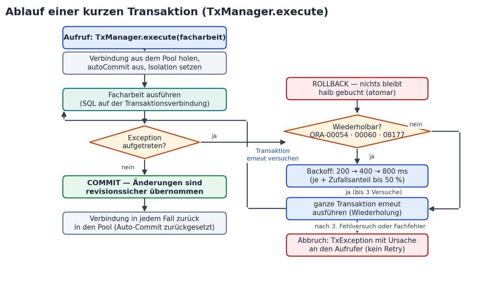
</p>

### 2. Saga-Engine für mehrtägige Geschäftsvorgänge
Fachliche Abläufe wie **Antragseingang &rarr; Bedarfsermittlung &rarr; Bewilligungsbescheid &rarr; Kassenanordnung &rarr; SEPA-Auszahlung** dürfen keine relationalen Zeilensperren über Stunden oder Tage halten. Die Saga-Engine führt Einzelschritte mit separaten Transaktionen aus und sichert den Zustand im persistenten Journal:

```java
SagaDefinition antragSaga = SagaDefinition.of("ANTRAGSVERARBEITUNG")
    .step("Antrag anlegen",     this::antragSpeichern,    this::antragStornieren)
    .step("Bedarf ermitteln",   this::bedarfFeststellen,  this::bedarfZuruecksetzen)
    .step("Bescheid erstellen", this::bescheidErteilen,   this::bescheidAufheben)
    .step("Zahlung anordnen",   this::zahlungAnordnen,    this::zahlungStornieren)
    .build();

// Ausführung mit automatischer Rückwärts-Kompensation bei Fehlern:
String sagaId = sagas.run(antragSaga, payload);

// Bei Systemabsturz: Automatische Fortsetzung beim Server-Neustart:
int kompensiert = sagas.recover(antragSaga);
```

<p align="center">
  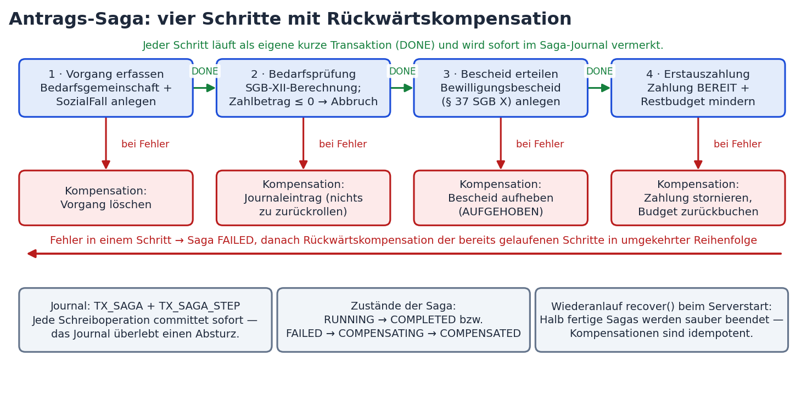
</p>

---

## ⚖️ Fachliche Berechnungsengine (SGB XII – Stand 2026)

Die Leistungsberechnung ist als seiteneffektfreie, deterministische Funktion in `de.allgemein.lmg.calc.Leistungsberechnung` realisiert und durch umfassende Unit-Tests verifiziert:

<p align="center">
  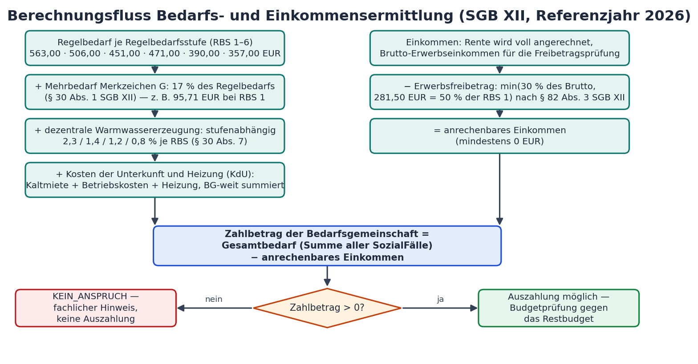
</p>

| Gesetzliche Vorgabe | Gesetzesgrundlage | Parameter & Wert (2026) |
|:---|:---|:---|
| **Regelbedarfsstufen (RBS 1–6)** | § 27a SGB XII / Anlage zu § 28 | RBS 1: **563,00 €** · RBS 2: **506,00 €** · RBS 3: **451,00 €**<br>RBS 4: **471,00 €** · RBS 5: **390,00 €** · RBS 6: **357,00 €** |
| **Mehrbedarf Gehbehinderung** | § 30 Abs. 1 SGB XII (Merkzeichen G) | **17 %** des maßgeblichen Regelbedarfs (RBS 1: 95,71 € / RBS 2: 86,02 €) |
| **Mehrbedarf Schwangerschaft** | § 30 Abs. 2 SGB XII | **17 %** ab der 12. Schwangerschaftswoche (RBS 1: 95,71 €) |
| **Mehrbedarf Alleinerziehende** | § 30 Abs. 3 SGB XII | Basis stets **RBS 1**: **36 %** (Kind u. 7 J. oder 2–3 Kinder u. 16 J.), sonst **12 % je minderjähriges Kind**, Deckel **60 % RBS 1** (337,80 €) |
| **Mehrbedarf Warmwasser** | § 30 Abs. 7 SGB XII | Stufenabhängig: **2,3 %** (RBS 1/2), **1,4 %** (RBS 4), **1,2 %** (RBS 5), **0,8 %** (RBS 6); RBS 3 ohne Satz |
| **Obergrenze der Mehrbedarfe** | § 30 Abs. 6 SGB XII | Summe der Mehrbedarfe höchstens der Regelbedarf selbst |
| **Kosten der Unterkunft (KdU)** | § 42a i.V.m. § 35 SGB XII | Kaltmiete + kalte Betriebskosten + Heizkosten; Angemessenheitsgrenze je Bedarfsgemeinschaft (§ 35 Abs. 7); Warmwasser-Abzug nur bei zentraler Erzeugung konfigurierbar; Karenzzeit/Absenkungsfrist nicht abgebildet |
| **Absetzbeträge vom Einkommen** | § 82 Abs. 2 SGB XII | Steuern, Sozialversicherung, Versicherungen, Erwerbsaufwendungen |
| **Erwerbseinkommensfreibetrag** | § 82 Abs. 3 SGB XII | $\min(30\,\%\text{ Brutto}, 50\,\%\text{ RBS 1} = 281{,}50\text{ €})$ |
| **Vermögensanrechnung** | § 43 Abs. 1, § 90 Abs. 2 Nr. 9 SGB XII i.V.m. § 1 BarbetragsVO | Schonvermögen **10.000 €** je volljähriger Person (RBS 1–3) + **500 €** je überwiegend unterhaltener Person (RBS 4–6); Verwertbares mindert den Zahlbetrag |
| **Monatlicher Zahlbetrag** | § 43a SGB XII | $\text{Gesamtbedarf der BG} - \text{anrechenbares Einkommen} - \text{verwertbares Vermögen}$ |

---

## 🖥️ Einblick in die SDN.sozial Web-Oberfläche

Die Web-Oberfläche (`src/main/resources/webapp/`) ist als reaktive Single-Page-Application konzipiert. Sie bietet modernste Behörden-Ergonomie im Dark-/Light-Glassmorphism-Stil.

### Fallübersicht & Vorgangs-Dashboard
Vollständige Übersicht aller aktiven Bedarfsgemeinschaften, Fristen-Wächter (Wiedervorlage), Budgetüberwachung und Ein-Klick-Direktansprung in die Sachbearbeitung.

<p align="center">
  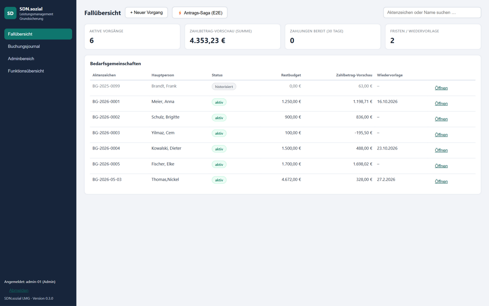
</p>

### SGB-XII-Bedarfsermittlung & Berechnungsblatt
Automatische Berechnung aller Leistungsansprüche bei Eingabe von Miete, Heizung, Mehrbedarfen und Einkünften mit visueller Plausibilitätsprüfung.

<p align="center">
  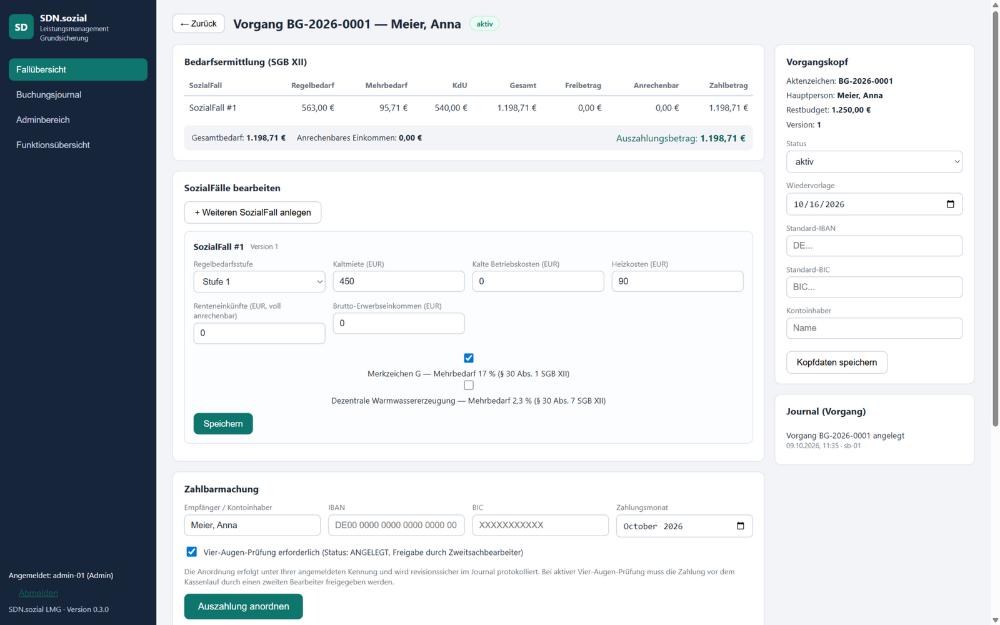
</p>

### Strikte Compliance: Vier-Augen-Prinzip & SEPA-Auszahlung
Keine Auszahlung ohne Zweitfreigabe! Jede Zahlung startet im Status `ANGELEGT` und muss durch einen zweiten Sachbearbeiter rechnerisch festgestellt werden. Versucht der Erfasser die eigene Anordnung freizugeben, wehrt der Server das serverseitig ab und protokolliert den Versuch im Journal:

<p align="center">
  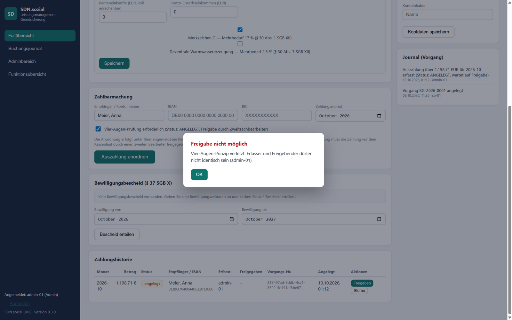
</p>

Nach Anmeldung des zweiten Sachbearbeiters (`sb-01`) wird die Freigabe erteilt. Alle Bankverbindungen sind SEPA-validiert (IBAN-Prüfung nach ISO 13616 mit Modulo-97-Prüfziffer):

<p align="center">
  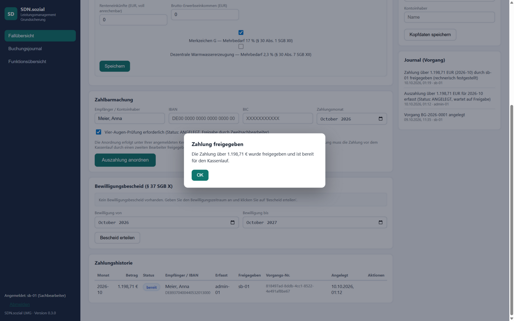
</p>

<p align="center">
  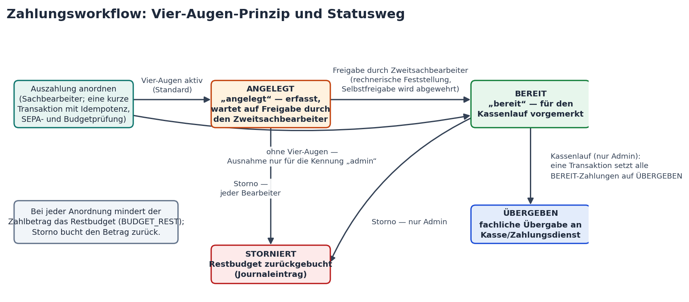
</p>

### Behördenkonformes Bescheidwesen (§ 44 SGB XII, §§ 35–39 SGB X)
Druckfertige Generierung rechtssicherer Bewilligungsbescheide mit fallbezogener Begründung, Berechnungsbogen, KdU-Vorbehaltskennzeichnung und konfigurierbarer Rechtsbehelfsbelehrung direkt im Browser:

<p align="center">
  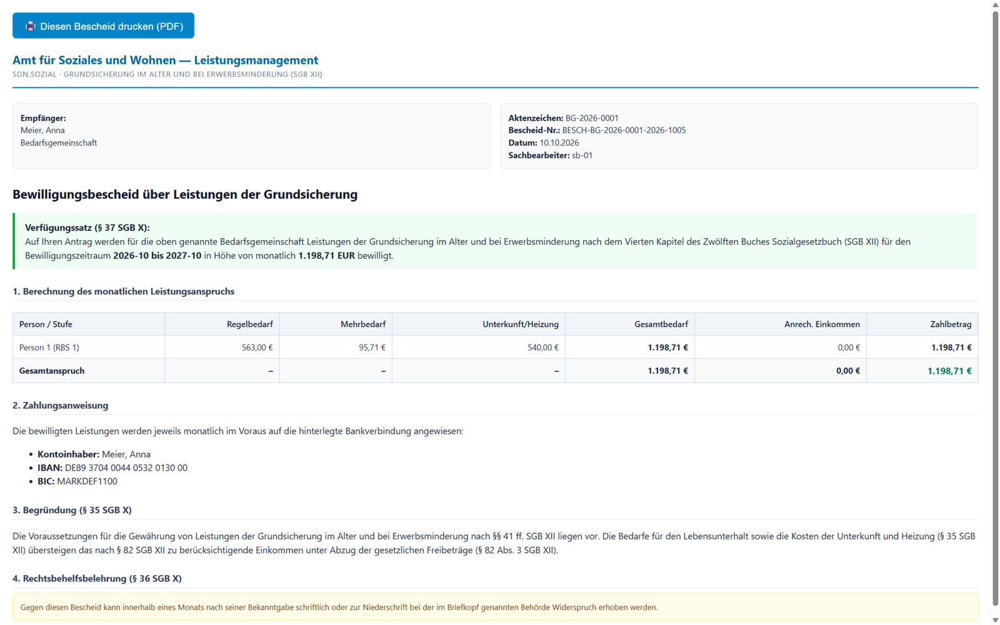
</p>

### Revisionssicheres Buchungsjournal & Systemdiagnose
Jede Statusänderung, jede Buchung und jeder Login wird unveränderbar protokolliert. Das integrierte Diagnose-Cockpit visualisiert laufende Threads, DB-Latenzen und Pool-Auslastung.

<p align="center">
  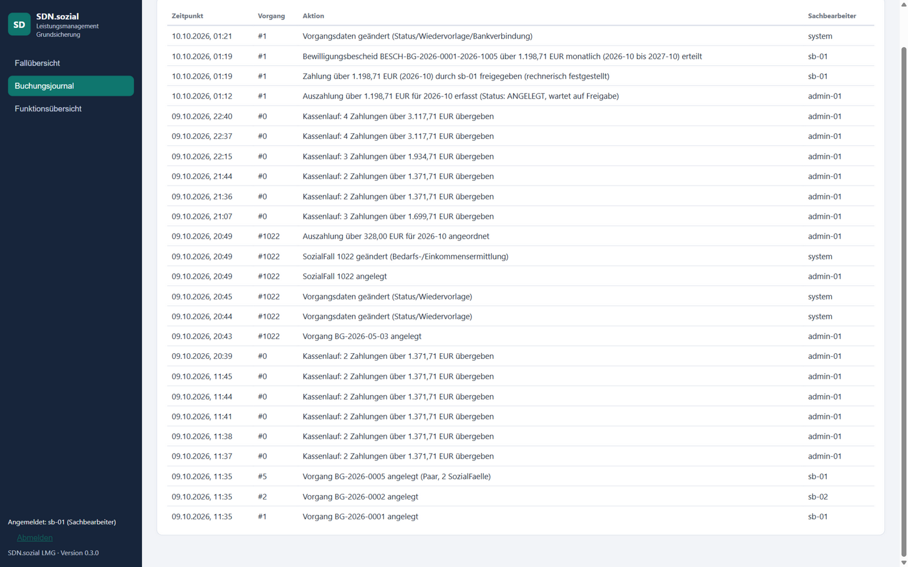
  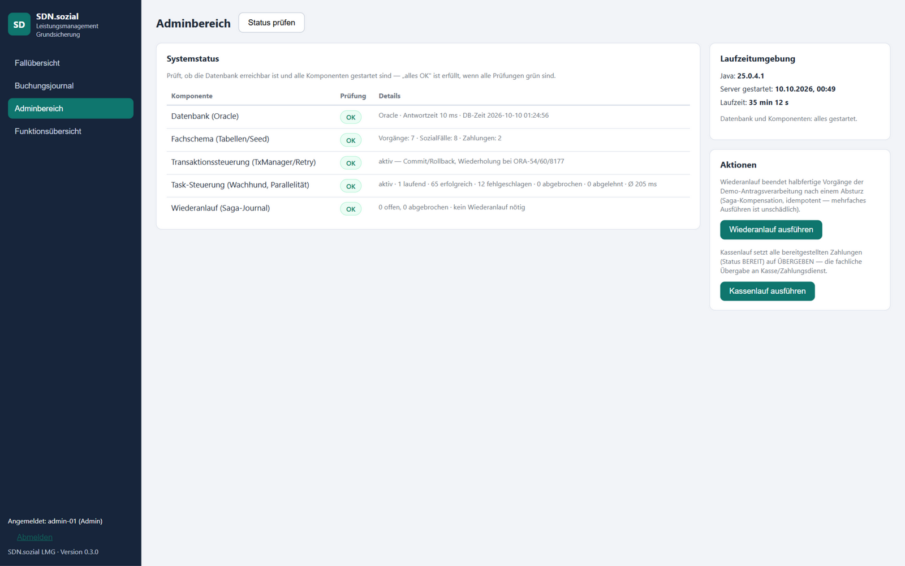
</p>

---

## 🚀 Schnellstart & Lokale Ausführung

### Voraussetzungen
* **Java Development Kit (JDK) 21** oder neuer (getestet bis JDK 25)
* **Apache Maven 3.9+**
* **Oracle Database**: Vorkonfiguriert für **Oracle 19c Enterprise Edition** (VirtualBox Linux) oder **Oracle 23ai Free** (Docker).

### 1. Datenbank bereitstellen

**Option A: Schneller Start via Docker (Oracle 23ai Free)**
```bash
docker run -d --name lmg-oracle -p 1521:1521 \
  -e ORACLE_PASSWORD=tx_demo \
  -e APP_USER=tx_demo -e APP_USER_PASSWORD=tx_demo \
  -v lmg-oracle-data:/opt/oracle/oradata \
  gvenzl/oracle-free:23-slim-faststart

export TX_URL="jdbc:oracle:thin:@//localhost:1521/FREEPDB1"
export TX_USER=tx_demo
export TX_PASS=tx_demo
```

**Option B: Standardmäßige VirtualBox-VM (Oracle 19c Enterprise)**
```bash
export TX_URL="jdbc:oracle:thin:@//localhost:1921/o19c1p1"
export TX_USER=tx_demo
export TX_PASS=tx_demo
```

### 2. Der 1-Klick-Start (Windows)
Das mitgelieferte Startskript prüft die Umgebung, initialisiert die Schemata und startet den Webserver:
```cmd
start.bat
```
*Öffnet automatisch den Browser unter `http://localhost:8080`.*

### 3. Manuelle Ausführung via CLI
```bash
# 1. Schemata & Demo-Bestand einspielen
sqlplus tx_demo/tx_demo@... @ddl/oracle_schema.sql
sqlplus tx_demo/tx_demo@... @ddl/lmg_schema.sql
sqlplus tx_demo/tx_demo@... @ddl/lmg_seed.sql

# 2. Testsuite ausführen (Unit-Tests laufen ohne DB; die DB-Tests brauchen TX_URL)
mvn test

# 3. Server starten
mvn compile exec:java -Dexec.mainClass=de.allgemein.lmg.web.LmgServerMain
```

### 4. Vorkonfigurierte Benutzerkonten

| Benutzerkennung | Passwort | Rolle | Berechtigungen |
|:---|:---|:---|:---|
| **`admin-01`** | `admin` | **Administrator** | Systemdiagnose, Kassenlauf, Storno, Saga-Wiederanlauf |
| **`sb-01`** | `sb-01` | **Sachbearbeiter** | Fallbearbeitung, Bescheiderteilung, Vier-Augen-Freigabe |
| **`sb-02`** | `sb-02` | **Sachbearbeiter** | Fallbearbeitung, Bescheiderteilung, Vier-Augen-Freigabe |

---

## 📡 REST-API Übersicht

Der integrierte JDK-HttpServer stellt alle Fach- und Systemfunktionen über eine leichtgewichtige JSON-API bereit:

| Methode | Endpunkt | Funktion & Berechtigung |
|:---|:---|:---|
| `POST` | `/api/anmeldung` · `/api/abmeldung` | Anmeldung (Token) / Abmeldung |
| `GET` | `/api/werbin` | Angemeldete Kennung und Rolle |
| `GET` | `/api/bedarfsgemeinschaften` | Liste aller Fälle mit Schnellberechnung des Zahlbetrags |
| `POST` | `/api/bedarfsgemeinschaften` | Neuen Vorgang anlegen (Aktenzeichen eindeutig, Startbudget, Vermögen) |
| `GET` | `/api/bedarfsgemeinschaften/{id}` | Vorgangsdetail mit SozialFällen, Bescheiden & Zahlungen |
| `PUT` | `/api/bedarfsgemeinschaften/{id}` | Stammdaten aktualisieren (Optimistisches Locking via `VERSION`) |
| `POST` | `/api/bedarfsgemeinschaften/{id}/sozialfaelle` | Weitere Person zum Vorgang anlegen |
| `PUT` | `/api/sozialfaelle/{id}` | Einzelperson anpassen (Miete, Einkommen, Mehrbedarfe, Absetzbeträge) |
| `POST` | `/api/auszahlung` | Auszahlung erfassen — immer Status `ANGELEGT` (Idempotenz via `vorgangsNr`) |
| `POST` | `/api/zahlungen/{id}/freigabe` | Vier-Augen-Freigabe (Prüft serverseitig `SACHBEARBEITER_ID != FREIGEBER`) |
| `POST` | `/api/zahlungen/{id}/storno` | Storno mit Restbudget-Rückbuchung *(Admin)* |
| `GET` | `/api/zahlungen` | Letzte Zahlungen über alle Vorgänge |
| `POST` | `/api/kassenlauf` | Alle `BEREIT`-Zahlungen an die Kasse übergeben *(Admin)* |
| `POST` | `/api/bedarfsgemeinschaften/{id}/bescheid` | Bewilligungsbescheid erteilen (§ 44 SGB XII) |
| `GET` | `/api/bedarfsgemeinschaften/{id}/bescheid/druck` | Druckansicht des amtlichen Bescheids |
| `POST` | `/api/saga/antrag` | End-to-End-Antragsverarbeitung als Saga |
| `GET` | `/api/journal` | Revisionssicheres Buchungsjournal abrufen |
| `GET` | `/api/system/status` | Systemdiagnose: DB-Verbindung, Latenz, Pool, Task-Stats *(Admin)* |
| `POST` | `/api/system/wiederanlauf` | Saga-Crash-Recovery manuell triggern *(Admin)* |

---

## 📚 Begleitende Dokumentation & Praxishandbuch

Im Ordner [`doc/`](doc/) stehen ausführliche Architekturberichte und das offizielle Benutzerhandbuch bereit:

<p align="center">
  <a href="doc/SDN-sozial-LMG-Benutzerhandbuch.pdf">
    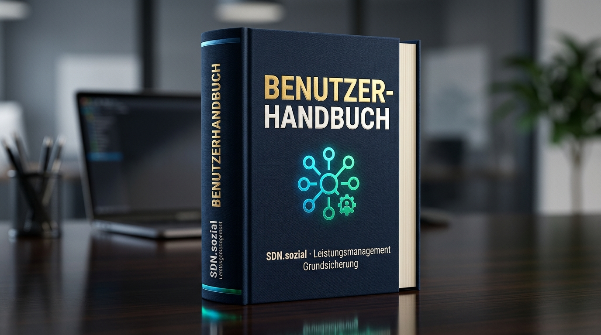
  </a>
  <br>
  <strong><a href="doc/SDN-sozial-LMG-Benutzerhandbuch.pdf">📖 SDN-sozial-LMG-Benutzerhandbuch.pdf (42 Seiten, Vollständige Referenz)</a></strong>
</p>

* [doc/architektur.md](doc/architektur.md) — Detaillierte Baustein-Architektur, Concurrency-Regeln und Datenfluss
* [doc/leistungsmanagement.md](doc/leistungsmanagement.md) — Fachspezifikation des Sozialleistungsrechts und Schnittstellen
* [doc/projektbeschreibung.md](doc/projektbeschreibung.md) — Motivation, CICS-Ablösung und wirtschaftlicher Kontext
* [doc/roadmap.md](doc/roadmap.md) — Umsetzungsstand und geplante Enterprise-Ausbaustufen

---

## 📄 Lizenz & Urheberrecht

Entwickelt von **Thomas Nickel** ([tnickel-ki.de](https://tnickel-ki.de)) als Architektur- und KI-Demonstrator.  
Lizenziert unter der [MIT-Lizenz](LICENSE). Alle Musterdaten, Namen und Aktenzeichen sind frei erfunden.
